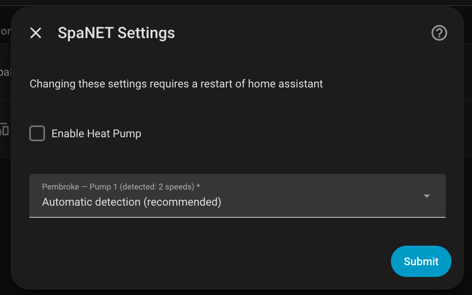
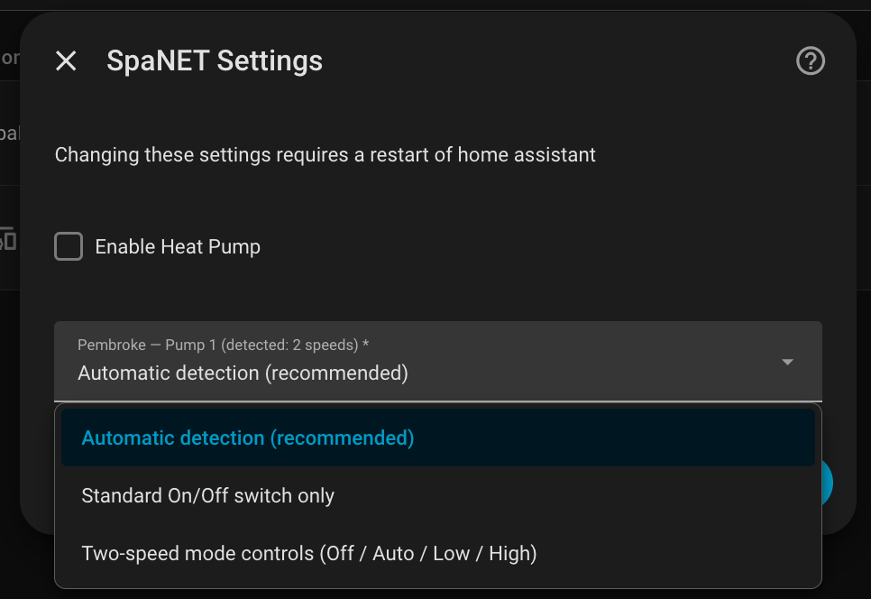
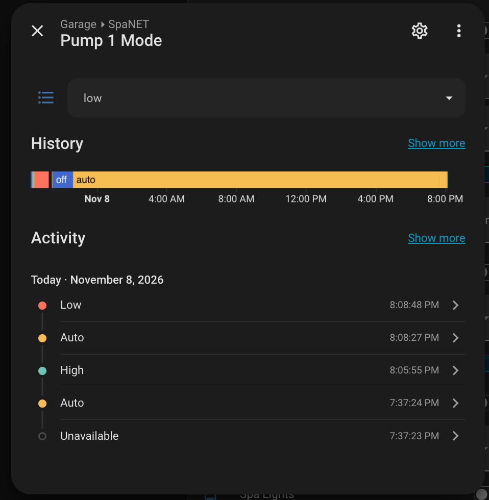
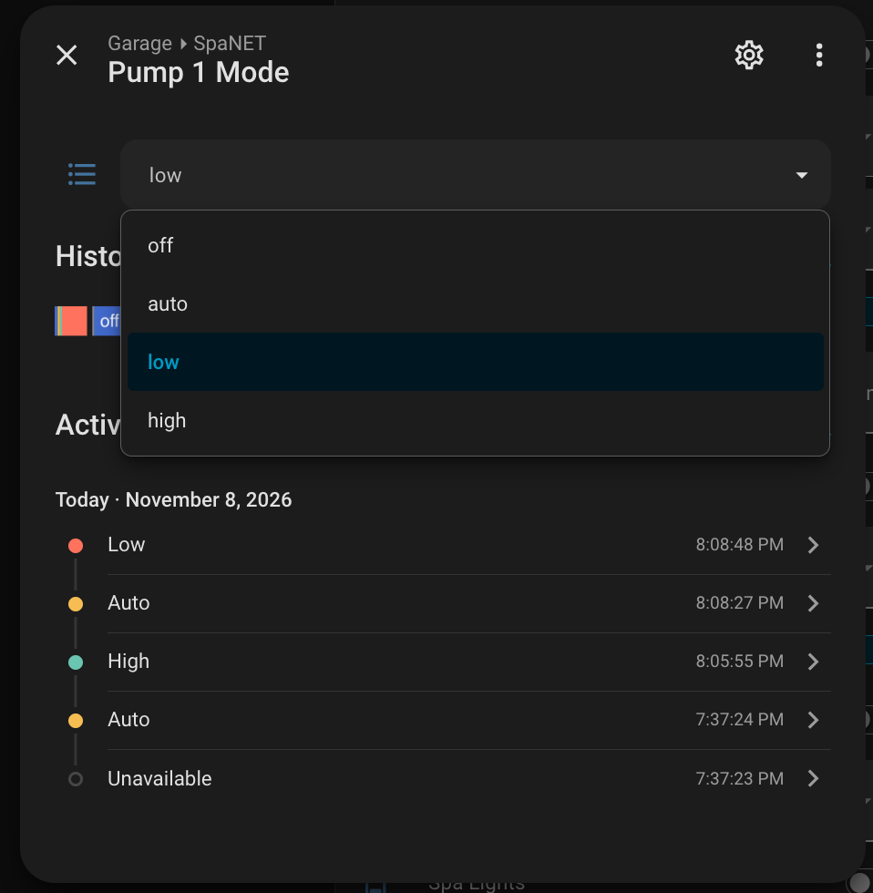

# SpaNET v1.2.0-rc.1 — Two-speed pump support and GUI configuration

> **Community fork pre-release · For supervised testing**
>
> This is an unofficial release candidate of [lloydw/hass-spanet](https://github.com/lloydw/hass-spanet), based on upstream **v1.1.0**. It is not an official release by the upstream maintainer.

This update introduces **automatic pump-speed detection**, individual pump configuration through the **Home Assistant GUI**, and faster, API-confirmed feedback after pump mode changes. Existing On/Off pump switches remain available for compatibility.

## Highlights

### Configure each spa pump in the GUI

Open **Settings → Devices & Services → SpaNET → Configure**. Alongside the existing **Enable Heat Pump** option, each discovered pump gets its own setting:

| Control preference | Behaviour |
| --- | --- |
| **Automatic detection** *(default)* | Uses the speed count reported by SpaNET. Controllable two-speed pumps gain an additional Off / Auto / Low / High selector; existing pump switches remain. |
| **Standard On/Off switch only** | Hides the additional mode selector. The original pump switch remains; a user can explicitly add one for a supported single-speed pump that previously exposed only a status sensor. |
| **Two-speed mode controls** | Enables the mode selector on confirmed two-speed hardware. If the API reports one speed, the user must acknowledge a prominent warning, and the pump must still report a controllable output. |

Preferences are stored **per spa ID and pump number**, supporting multiple spas on one account and multiple pumps on a single spa. Hardware reporting three or more speeds is not automatically treated as a two-speed pump.

**Existing installations require no manual migration.** If no preference is saved, automatic detection applies. Saving configuration reloads **only the SpaNET integration**; it does not issue any pump commands. Previously existing pump switch entity IDs and On/Off command payloads are preserved.

### Pump control in Home Assistant

For a controllable two-speed pump, the additional mode selector offers **Off**, **Low**, **High**, and **Auto** (only when the controller reports Auto support). A read-only mode sensor exposes the cloud-reported mode.

### Technical reference: SpaNET pump API mode IDs

These mappings were identified by inspecting the pump-control implementation in the **official SpaNET SmartLINK Android app (v2.0.12)** and are now reflected in this integration's API wrapper and regression tests. The **Off, Auto, Low and High** modes were also exercised against a physical Pembroke two-speed pump, with the motor and official app responding as expected.

| Command | API `modeId` | How used |
| --- | ---: | --- |
| On | `1` | Existing legacy On/Off switch command |
| Off | `2` | Both legacy switch and new mode selector |
| Auto | `3` | Two-speed pump selector, when the controller supports Auto |
| Low | `5` | Two-speed pump selector |
| High | `6` | Two-speed pump selector |

The endpoint is `PUT /PumpsAndBlower/SetPump/{pumpId}`, with a JSON body containing `deviceId`, `modeId`, and `pumpVariableSpeed`.

**Important: `pumpVariableSpeed` is a separate request field from `modeId`.** The original On/Off switch keeps `pumpVariableSpeed: 0`; the new two-speed selector sends `pumpVariableSpeed: 5` for all its modes (including Off). The two values of `5` in `modeId: 5` (Low) and `pumpVariableSpeed: 5` should not be conflated.

For example, requesting **High** with the new selector sends:

```json
{
  "deviceId": "<spa-device-id>",
  "modeId": 6,
  "pumpVariableSpeed": 5
}
```

**Scope of validation:** The numeric mapping is based on the inspected app version and the tested hardware. The On (`1`) path is preserved from the pre-existing integration and verified by payload regression tests; the four selector modes were validated on the Pembroke pump. No meaning is asserted for unlisted IDs (including `4`), and this should not be assumed to apply to every SpaNET controller or firmware variant. The cloud's reported *status strings* are a separate readback mechanism, not these command IDs.

After a command sent through the new selector, SpaNET attempts an API-confirmed readback after approximately **7 seconds**, with **one bounded retry** after a further 15 seconds if needed. It does not display an optimistic state. Normal pump polling remains at approximately **five minutes**, so changes made through the official app may still take longer to appear in Home Assistant.

### More reliable startup

Temporary **HTTP 202** responses from SpaNET during login, device discovery or the first data refresh are now handled as transient failures. Instead of creating partially initialized entities, Home Assistant can retry the integration setup using its normal retry mechanism. This does not eliminate all possible cloud API errors during ordinary operation.

## Screenshots

### SpaNET configuration

The existing heat-pump checkbox and new per-pump automatic-detection setting:



The three options available for the detected pump:



*Screenshot note: these development captures contain an older cached description claiming a full Home Assistant restart is needed. The updated options flow applies settings by reloading SpaNET only; a full Home Assistant restart is not required.*

### Pump mode controls

The new Pump 1 mode entity with its state and Home Assistant history:



The expanded mode selector showing the four supported choices:



## Testing and compatibility

- **Physical test hardware:** Pembroke Spa using SmartLINK V2, with a two-speed Pump 1.
- **Confirmed:** Off, Auto, Low and High commands against the official SpaNET app and physical motor; mode sensor feedback approximately **7 seconds** in the observed High and Off tests.
- **GUI test:** Automatic detection selected and saved through Home Assistant; SpaNET reloaded successfully and all **24 existing Pembroke entities** remained available, including the original Pump 1 switch and the new selector/sensor.
- **Automated checks:** **58 offline regression tests**, Home Assistant container import, and hassfest all passed for Stage 4.1. See [CI evidence](https://github.com/Galahad2304/hass-spanet/actions/runs/42455439749).
- **Backward compatibility:** Unconfigured existing installations default to automatic detection. Tests cover single- and two-speed models, mixed pump types, per-pump preference isolation, legacy switches and API command payloads.

## Known limitations and safety notes

- This is a **pre-release** intended for users comfortable testing spa controls and restoring an earlier integration if necessary.
- **Physical single-speed spa hardware and mixed multi-pump installations have not yet been tested.** Compatibility is covered by offline fixtures, not every controller in the field.
- Manual two-speed override on hardware reported as one-speed is **experimental and potentially unsafe**. Only use it if the actual hardware supports two speeds and you can supervise operation.
- The automatic HTTP 202 startup-retry path passed simulated tests and normal restart/reload checks, but has not been deliberately tested through a live outage.
- If a user deliberately chooses On/Off-only mode for an existing two-speed installation, the **additional mode selector** will no longer be exposed after reload. Automations built against that additional selector may need review; legacy switches retain their entity IDs.
- The separate custom SpaNET dashboard card prototype is **not included** in this integration release.

## Installation and rollback

This is a release **from a fork**. Installing or updating the upstream `lloydw/hass-spanet` integration does **not** automatically install this candidate. Testers must explicitly select this fork's release through an appropriate installation method.

Before updating, back up `/config/custom_components/spanet` or take a Home Assistant backup, and record the current version. After installing, restart Home Assistant (required for the code update), verify SpaNET loads and entities are present, then open **Configure** and inspect each pump's detected capabilities. Future configuration changes within the new GUI reload just the integration.

If the integration fails to initialise, inspect the logs and consider **Reload**; restore the previous integration files if needed.

## Attribution and contribution

Based on [lloydw/hass-spanet](https://github.com/lloydw/hass-spanet) by Lloyd Weehuizen and contributors, licensed under the repository's existing **MIT License**. This is a community fork release candidate intended to help review and test a potential upstream contribution, not a replacement for the official project.
